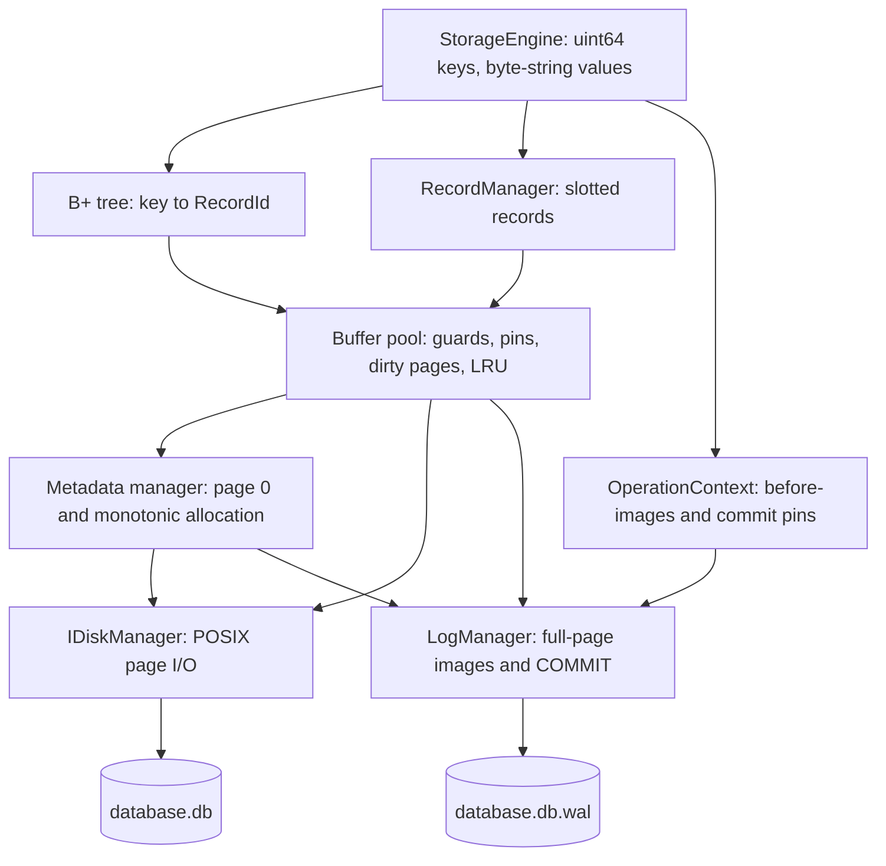

# RohanDB

A C++20 persistent key/value storage engine built from first principles, covering
the core, robustness, and full-page WAL recovery milestones. It is a learning
project, not a production database.

**File format:** database format **4** and WAL format **2**. Page 0 holds the
metadata, page 1 is a permanent immutable identity page, and data/tree allocation
starts at page 2.

## Architecture



The original `Database` string-key unordered-map prototype remains available as
an educational reference. The persistent public API is `StorageEngine`; it uses
64-bit integer keys and does not hash strings into keys.

## Build and test

Requires CMake 3.20+, a C++20 compiler, and a POSIX platform. macOS uses
`F_FULLFSYNC`; other POSIX builds use `fsync`. No third-party storage library or
runtime web dependency is required.

```sh
cmake -S . -B build -DCMAKE_BUILD_TYPE=Debug -DSE_SANITIZE=ON
cmake --build build -j
ctest --test-dir build --output-on-failure
```

Warnings: `-Wall -Wextra -Wpedantic -Wconversion -Wshadow`. The sanitizer option
adds AddressSanitizer and UndefinedBehaviorSanitizer. Test assertions stay active
in Release builds too. The recovery tests intentionally simulate crashes; error
messages from best-effort destructor close are expected during those tests.

For earlier milestone builds, use `-DSE_WAL=OFF` (checksums, no crash recovery),
or `-DSE_WAL=OFF -DSE_CHECKSUMS=OFF` (core format). Feature flags reject opening
files from a different milestone; there is no migration tool. Recovery-specific
tests are registered only in the checksum/WAL build.

## Use the engine

```cpp
#include <rohandb/engine/storage_engine.hpp>

rohandb::StorageEngine db;
rohandb::EngineOptions options;
options.buffer_pool_frames = 64;
options.sync_mode = rohandb::SyncMode::EveryOperation;
db.open("example.db", options);
db.put(42, "hello");                  // true if inserted; false if replaced
const auto value = db.get(42);        // optional<string>
{
    auto it = db.scan(40);            // ordered lower-bound scan
    while (it.valid()) {
        // it.key(), it.value()
        it.next();
    }
}                                    // iterators must die before close()
db.close();                          // surfaces flush/checkpoint errors
```

Values contain arbitrary bytes, including NULs, up to **4054 bytes**. Oversized
values are rejected before any page is modified. Missing keys are ordinary return
values. Other errors throw `DbError` with an `ErrorCode`.

```sh
build/rohandb_cli demo.db put 42 hello
build/rohandb_cli demo.db get 42
build/rohandb_cli demo.db scan 0
build/rohandb_cli demo.db verify
build/db_inspect demo.db meta
build/db_inspect demo.db page 1   # immutable identity
build/db_inspect demo.db page 2   # initial root
build/db_inspect demo.db btree
build/db_inspect demo.db record 3 0
build/db_inspect demo.db verify
build/db_inspect demo.db wal
```

The inspector opens read-only and **never runs recovery**. It reports committed
WAL operations with unapplied images. Inspect a quiescent database; concurrent
access by another process is unsupported.

## Page and record layout

All pages are 4096 bytes. Every persisted field has a named offset in
`storage/page_layout.hpp`; unsigned scalars are encoded explicitly in little-endian
order. C++ object representations, pointers and STL objects are never persisted.

```text
Data page
0       16          24                     4096
| common | data hdr | slots --> | gap | <-- payloads |

Common header: checksum u32, type u8, reserved[3], page_lsn u64
Slot:          offset u16, length u16, occupied flags u16
Record:        key u64, value_length u32, value bytes
RecordId:      page_id u32 + slot_id u16 (encoded as six bytes)
```

Compaction moves payloads and rewrites offsets while preserving slot IDs. Leaves
hold 290 key/RecordId entries; internal nodes hold 339 children at physical
capacity. Tests use capacity 4 to exercise splitting. Delete does not merge nodes;
separators remain routing bounds even when a child becomes empty.

## Durability and recovery

| Build/mode | Successful operation guarantee |
|---|---|
| Core / checksums only | Clean flush/close persists the file; no crash safety |
| WAL `OnFlush` (default) | Atomic operations; durable after flush/checkpoint/close |
| WAL `EveryOperation` | WAL commit is forced before the operation returns |

```mermaid
sequenceDiagram
    participant E as Engine
    participant P as Buffer pool
    participant W as WAL
    participant D as Database file
    E->>P: Register before-images; hold pins; modify pages
    E->>W: Append page images then COMMIT
    Note over E,W: EveryOperation forces WAL here
    E->>P: Release operation pins
    P->>W: Force all pending records before any dirty write
    P->>D: Write page with checksum and LSN
```

Recovery replays full-page images for committed operations, including page zero,
then syncs and validates the database. Before replay, the WAL database ID must
match the separately checksummed immutable identity page; page-zero WAL images
must carry that same ID. A corrupt identity page is rejected, not guessed. It tolerates torn trailing WAL records and
repairs torn database pages when a committed image is available. Checkpoints
force WAL, write/sync data, write/sync already-dirty metadata, then atomically replace the WAL
header and sync its directory. Automatic checkpoint threshold: 64 MiB of log
records since the last checkpoint (configurable through `checkpoint_wal_bytes`).
The informational `last_checkpoint_lsn` is no longer updated: rewriting clean
metadata would create an unlogged torn-write risk.

A failed mutation before commit rolls back bytes, metadata allocation, insertion
hints, and operation pins. Commit/log-sync uncertainty enters Failed state; close
then avoids further flushing. A failed WAL is permanently unusable in that engine
instance, including from reads and existing iterators; flush/reset/append are not
retried. Close releases resources without issuing checkpoint writes. Before WAL, Failed state cannot undo earlier dirty
evictions, so reopening does not necessarily restore the last flush.

New databases are built as a complete three-page file under a temporary name,
forced to storage, then published by rename and directory sync. The WAL header
is initialized only after publication. A missing or empty database with a nonempty
WAL is rejected before any replay. Publication leaves either an empty/missing
file or a complete initial database after a crash, never half-built page zero.
Unexpected orphan temporary files can remain after a process crash; they are not
opened automatically. Concurrent opens remain unsupported.

## Performance lab

Build Release without sanitizers for measurements:

```sh
cmake -S . -B build-release -DCMAKE_BUILD_TYPE=Release
cmake --build build-release -j
build-release/rohandb_benchmark 10000 64 random > random.json
build-release/rohandb_benchmark 10000 64 sequential > sequential.json
build-release/rohandb_benchmark 10000 64 random every > durable.json
```

Arguments: key count (1–1,000,000), frames, `random` or `sequential`, and optional
`every` for per-operation sync. Benchmarks use dedicated temporary database files,
verify their results, and remove those files on success. They export throughput,
read latency percentiles, cache hit rate, page I/O, evictions, and WAL amplification.

For a repeatable workload matrix (with machine metadata):

```sh
python3 tools/benchmark_matrix.py build-release/rohandb_benchmark --keys 10000 --frames 8 64 4096 > matrix.jsonl
```

Add `--include-every` to compare both sync modes; durable per-operation sync can
make the run substantially slower. Run benchmarks sequentially on an otherwise
idle machine and repeat them before drawing performance conclusions.

Open **[the dashboard](tools/dashboard/index.html)** in a browser and import the
JSON files (or a JSONL file). It compares runs and displays the selected run's
latencies. No server, CDN, database connection, or telemetry is involved; viewing
results executes no engine code. Timing belongs to the benchmark harness. Cache
counters have a small runtime cost; these are measured runs, not zero-overhead
live monitoring. Read I/O counters refer to buffer-pool I/O, not OS physical reads.
WAL throughput and page-cache throughput are different measurements.

## Tests and implementation map

| Area | Source | Validation |
|---|---|---|
| Types, errors, serialization | `common/` | Exact byte order, bounds, rejected writes |
| Disk and metadata | `disk_manager.hpp`, `storage/meta_manager.hpp` | Reopen, EOF, short reads, metadata checks |
| Slotted records | `storage/slotted_page.hpp` | Slot reuse, compaction, corruption, value limits |
| Cache and guards | `buffer/` | Tiny pools, dirty eviction, failure state, move-only pins |
| Index and engine | `index/`, `engine/` | Splits, updates, deletes, reference-model restart |
| Checksums and scans | `common/crc32c.hpp`, `index/range_iterator.hpp` | CRC vector, corruption, empty leaves, invalidation |
| WAL and recovery | `wal/`, `testing/simulated_storage.hpp` | Every WAL record truncation boundary, rollback, crash sweep |

The crash sweep exercises both sync modes and all three simulated crash models, with three seeds, automatic checkpoints,
and both sector- and byte-level tears:
lose unsynced writes, keep a reordered subset, and tear a write at a sector boundary.
It compares recovered contents against valid operation prefixes and reruns tree
verification. Separate tests interrupt recovery and repair corrupt page-zero bytes.
This is deterministic fault testing, not evidence of testing every hardware failure.

## Limits and trade-offs

- Single process and thread; no locking or simultaneous engine handles on one file.
- Individual puts/erases are atomic in WAL builds; no multi-operation transactions.
- Monotonic page allocation, no free-page reuse, no delete rebalancing.
- Old data-page free space is reused only through the current insertion-page hint.
- Full-page WAL is simple and repairs tears, but amplifies writes substantially.
- Modified pages stay pinned until commit: a too-small pool can reject a split.
  The operation rolls back. Tiny test nodes need more frames than normal nodes.
- Guards and iterators borrow engine memory and must not outlive it. Mutation
  invalidates iterators. Slot IDs have no generation counter and are not a public API.
- Checksums detect accidental corruption, not malicious tampering. After checkpoint,
  corruption without an available WAL image can be detected but not repaired.
- SQL, networking, concurrency, overflow values, variable-length keys, bulk loading,
  LRU-K/CLOCK, delta logging and free-page reclamation remain deferred as in §24.

The hardening pass includes a warmed-lookup CPU profile
and a standalone `rohandb_profile_lookup` target. Node decoding dominates that
sampled read workload; the profile documents the next optimisation target without
weakening corruption checks or claiming an unmeasured speedup.
